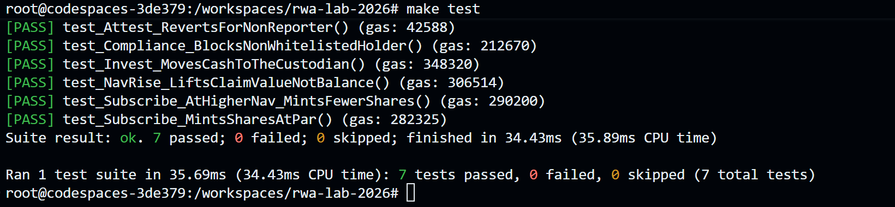
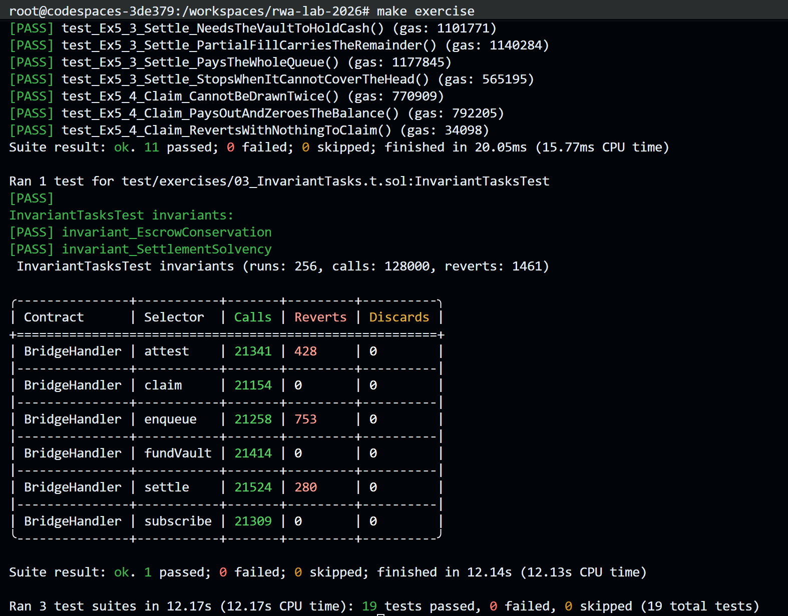
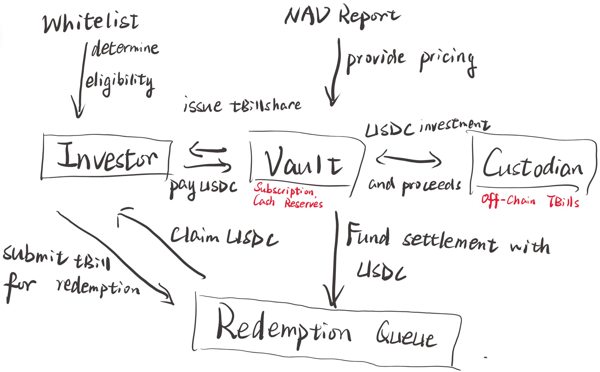

## 1. Make Exercise and make test passed screenshots:

## 2. architecture diagram:

## 3. Deployment (Sepolia)
MockUSDC: 0x2b88FBB0Aa9B6B11EA78f733caD041Eb164b7A12
https://sepolia.etherscan.io/address/0x2b88FBB0Aa9B6B11EA78f733caD041Eb164b7A12#code

ComplianceRegistry: 0x24aCC3876a286449D83F6f00c2b0AD752ddeAd4A
https://sepolia.etherscan.io/address/0x24aCC3876a286449D83F6f00c2b0AD752ddeAd4A#code

MockPriceFeed: 0x13cb01452c2dEfCc69e1B82c2dd70d79F1268605
https://sepolia.etherscan.io/address/0x13cb01452c2dEfCc69e1B82c2dd70d79F1268605#code

TBillToken: 0xe5a74b533feEdE5fe4D3dD4D117b19912F8e5001
https://sepolia.etherscan.io/address/0xe5a74b533feEdE5fe4D3dD4D117b19912F8e5001#code

MockTBillCustodian: 0xb6a18D868dbfF5fBD8f21971AD57D91548E96fE6
https://sepolia.etherscan.io/address/0xb6a18D868dbfF5fBD8f21971AD57D91548E96fE6#code

TBillVault: 0x48c4aE19f8E09F1009FAFC700ab85AefD33E43fb
https://sepolia.etherscan.io/address/0x48c4aE19f8E09F1009FAFC700ab85AefD33E43fb#code

RedemptionQueue: 0x51209A725E9B1e1bC33FA7642cBbAdA010c14C4d
https://sepolia.etherscan.io/address/0x51209A725E9B1e1bC33FA7642cBbAdA010c14C4d#code